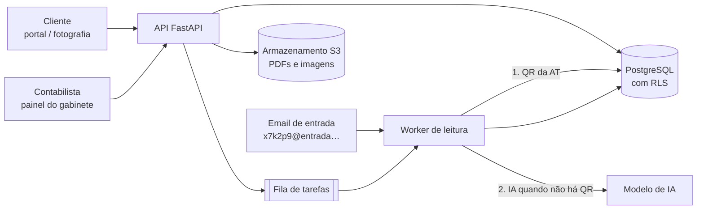

# Arquitetura

## Visão geral



## Escolhas técnicas

| Peça | Escolha | Porquê |
|---|---|---|
| Linguagem | Python 3.11+ | Já usado no estágio (FastAPI, ML). Bom para leitura de documentos e IA. |
| API | FastAPI | Rápido de escrever, validação automática, documentação OpenAPI gerada. |
| Base de dados | PostgreSQL 16 | Row Level Security para isolar gabinetes, JSONB, `NULLS NOT DISTINCT`. Disponível gerido (Supabase, Neon, RDS). |
| ORM e migrações | SQLAlchemy 2 + Alembic | Padrão em Python; migrações versionadas no git. |
| Ficheiros | S3 compatível (MinIO local; S3/R2 em produção) | Os PDFs não vão para a base de dados. |
| Fila de tarefas | A decidir (RQ/Redis ou tabela em Postgres) | A leitura de faturas é feita em segundo plano. |
| Frontend | A decidir na fase 2 | Painel do gabinete + portal do cliente. |

## Princípios
1. **Isolamento por gabinete na base de dados**, não só no código (RLS).
2. **QR primeiro, IA só quando é preciso.** Mais exato e mais barato.
3. **Nunca emitir faturas nem fazer contabilidade.** Somos o passo antes do
   software do contabilista, que continua a ser o TOConline, Primavera, PHC, Sage…
4. **Tudo auditável.** Quem carregou, quem alterou, quem exportou.
5. **Dados em Portugal/UE.** Alojamento na UE, por causa do RGPD.

## Estrutura de pastas
```
faturas-em-dia/
├── docker-compose.yml      PostgreSQL + MinIO locais
├── docker/postgres/        Script de arranque (papel faturas_app)
├── docs/                   Visão, arquitetura, modelo de dados, roadmap
└── backend/
    ├── app/
    │   ├── core/           Configuração e ligação à base de dados
    │   ├── domain/         Regras portuguesas sem base de dados (NIF, QR da AT, validações)
    │   ├── models/         Tabelas (SQLAlchemy)
    │   └── main.py         API
    ├── alembic/versions/   Migrações (esquema, dados base, RLS)
    └── tests/              Testes
```
