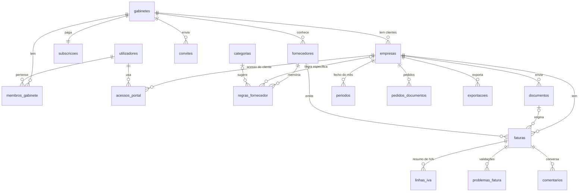

# Modelo de dados

PostgreSQL 16. Todas as tabelas usam `id` UUID e datas com fuso horário.
Valores monetários em `numeric(12,2)` (nunca `float`). Estados e tipos são
texto com `CHECK` (fácil de alargar numa migração).

## Diagrama

## Tabelas

### Contas e acessos (sem RLS — usadas no login)
| Tabela | Para quê |
|---|---|
| `gabinetes` | O gabinete de contabilidade: o cliente que paga (tenant). NIF único. |
| `utilizadores` | Qualquer pessoa que entra: contabilista ou cliente. Email único (sem distinguir maiúsculas). |
| `membros_gabinete` | Quem trabalha em que gabinete, com papel `dono`, `admin` ou `colaborador`. |
| `acessos_portal` | Que pessoas de uma empresa-cliente entram no portal dessa empresa. |
| `convites` | Convites por email (colaboradores e clientes). Só se guarda o hash do token. |
| `subscricoes` | Plano, estado, limite de empresas e preço acordado (em cêntimos). |

### Clientes e classificação
| Tabela | Para quê |
|---|---|
| `empresas` | Empresas-cliente do gabinete. NIF único por gabinete. Periodicidade e regime de IVA. `caixa_email` gera o endereço de entrada de faturas. |
| `fornecedores` | Fornecedores conhecidos, únicos por país + NIF dentro do gabinete. |
| `plano_contas` | Contas SNC. As linhas com `gabinete_id` NULL são a base comum; cada gabinete pode acrescentar as suas. |
| `categorias` | Categorias de despesa (linguagem do cliente) com conta e tratamento de IVA sugeridos. |
| `regras_fornecedor` | **Memória por fornecedor**: conta SNC + tratamento de IVA. `empresa_id` NULL = regra para todas as empresas; uma regra de uma empresa tem prioridade. Única por fornecedor + empresa (`NULLS NOT DISTINCT`). |

### Faturas
| Tabela | Para quê |
|---|---|
| `documentos` | Ficheiro original no armazenamento S3. `sha256` único por empresa: o mesmo ficheiro enviado duas vezes é recusado logo. Guarda o canal (upload, portal, email, API). |
| `faturas` | Dados da fatura: período (sempre dia 1 do mês), tipo AT, número, ATCUD, NIF, totais, moeda e câmbio, método de leitura (`qr`/`ia`/`manual`), texto do QR e dados extraídos pela IA, classificação e estado (`por_conferir` → `conferida` → `exportada`). Apagar é lógico (`eliminada_em`). |
| `linhas_iva` | Resumo de IVA por espaço fiscal (continente, Açores, Madeira) e tipo de taxa. Suporta faturas com várias taxas. |
| `problemas_fatura` | Resultado das validações (duplicado, NIF inválido, contas que não batem…). Só pode haver um problema aberto de cada tipo por fatura. |
| `comentarios` | Conversa sobre uma fatura entre o gabinete e o cliente. |

### Operação
| Tabela | Para quê |
|---|---|
| `periodos` | Estado de cada mês por empresa: `aberto`, `em_revisao`, `fechado`. |
| `pedidos_documentos` | Pedidos de faturas em falta enviados ao cliente. |
| `exportacoes` | Histórico do que foi exportado, em que formato e por quem. |
| `registo_atividade` | Auditoria (quem fez o quê). A aplicação só pode acrescentar, nunca alterar ou apagar. |

## Isolamento entre gabinetes (Row Level Security)

A regra mais importante do sistema: **um gabinete nunca vê dados de outro**.

1. A aplicação liga-se com o papel `faturas_app`, que **não** é dono das tabelas.
2. Cada pedido abre a sessão com `sessao_gabinete(gabinete_id)`, que faz
   `set_config('app.gabinete_id', …)` só para essa transação.
3. As políticas `isolamento_gabinete` (migração `0003`) filtram todas as
   leituras e recusam escritas noutro gabinete.
4. Sem gabinete definido, as tabelas aparecem vazias.

Isto protege mesmo quando uma consulta no código se esquece de filtrar por
gabinete. Está coberto por testes em `backend/tests/test_base_dados.py`.

## Decisões e notas
- **Período separado da data.** Uma fatura de 30/09 entregue tarde pode ser
  lançada em outubro; o contabilista decide.
- **Taxa de IVA calculada, não tabelada.** Guardamos base e IVA de cada linha;
  a percentagem é calculada. Evita manter tabelas de taxas por região e ano.
- **Campo C do QR é o país do *adquirente*, não do fornecedor.** O país do
  fornecedor de uma fatura com QR da AT é sempre PT.
- **Contas SNC são sugestões.** O plano de contas base é um subconjunto das
  contas mais usadas em compras e FSE; o gabinete confirma e acrescenta.
